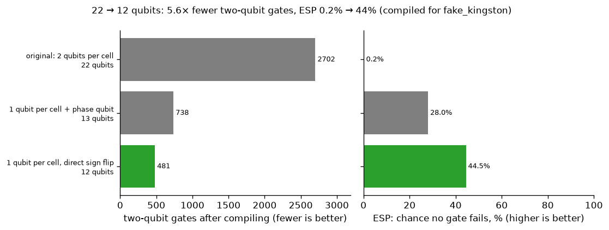

# Quantum Tic-Tac-Toe

[](https://github.com/RyanPrax/Quantum-TicTacToe/actions/workflows/tests.yml)

Tic-tac-toe where a quantum circuit decides who won. After every move from
turn 5 on, one step of Grover's search over the 8 winning lines points at the
line the player just completed, if any, and only that line is checked on the
board. The project takes the circuit from the original 22-qubit version to 12
qubits, measures how much of its signal survives realistic noise, and runs it
on IBM's quantum computers.



## Results

<!-- results:start -->
| | Result | Notebook |
| :--- | :--- | :--- |
| **Circuit** | 22 → 12 qubits, 2702 → 481 two-qubit gates (5.6× fewer), chance no gate fails (ESP) 0.2% → 44.5% on a simulated ibm_kingston | [01_how_it_works](notebooks/01_how_it_works.ipynb) |
| **Simulated noise** | Signal survives on all 3 free-plan devices, but measured noise is 0.03–0.14 above IBM's published figures; shots for ≤1% missed wins: kingston 256 (published data: 64), marrakesh 1536 (published data: 128), fez 7616 (published data: 192) | [02_noise](notebooks/02_noise.ipynb) |
| **Real hardware** | 48 boards on ibm_marrakesh: wins found on 22 of 32 (95% interval 51%–82%); no wrong winner reported | [03_hardware](notebooks/03_hardware.ipynb) |
<!-- results:end -->

## Read the notebooks

| Notebook | What it shows |
| :--- | :--- |
| **1. How it works** ([rendered](https://nbviewer.org/github/RyanPrax/Quantum-TicTacToe/blob/main/notebooks/01_how_it_works.ipynb) · [source](notebooks/01_how_it_works.ipynb)) | The circuit piece by piece on a perfect simulator, why exactly one Grover iteration, and how it went from 22 qubits to 12. |
| **2. Noise** ([rendered](https://nbviewer.org/github/RyanPrax/Quantum-TicTacToe/blob/main/notebooks/02_noise.ipynb) · [source](notebooks/02_noise.ipynb)) | The circuit on simulated copies of IBM's three free-plan devices, and how the noise measured in a run compares with IBM's published figures. |
| **3. Real hardware** ([rendered](https://nbviewer.org/github/RyanPrax/Quantum-TicTacToe/blob/main/notebooks/03_hardware.ipynb) · [source](notebooks/03_hardware.ipynb)) | Every job run on a real IBM device: the noise measured in it, every board at a glance (and one at a time in a board browser when run), and the findings and limitations. |

Each notebook opens with its question and result, and Part 1 ends with a
glossary. The "rendered" links open them on nbviewer, which is faster and more
reliable than GitHub's own viewer for notebooks of this size.

## Why quantum?

Not for speed. Checking 8 lines classically takes 24 cell lookups and no
qubits; this circuit needs hundreds of noisy two-qubit gates to point at the
right line, and tic-tac-toe is far too small for Grover's √N speedup to
matter. The point is the whole Grover pipeline (encoding, oracle, diffuser,
measurement, classical verification) on a problem small enough to check every
case, and an honest measurement of how much signal survives on today's
hardware.

## What this project demonstrates

- **Circuit optimization:** 22 → 12 qubits and several times fewer two-qubit
  gates, by encoding only the player who just moved and flipping the sign
  directly instead of through a helper qubit; compiled circuits scored on
  gate errors, idle decay and readout, with an optional ancilla kept only
  when it scores better.
- **Statistical detector design:** one Grover iteration chosen because it is
  the only count that separates single, double and no win; per-line cutoffs
  set from a binomial false-flag budget; every flagged line confirmed
  classically, so noise can never produce a wrong winner.
- **In-job calibration:** 20 calibration circuits in every job measure the
  readout matrix, gate noise and per-bit signal on the day, instead of
  trusting published calibration data, which understates the noise.
- **Real-hardware runs:** jobs on IBM devices saved with full provenance and
  re-scored from their saved counts whenever the analysis changes.
- **A tested package:** `src/qttt` with unit tests, notebook tests that fail
  when committed outputs go stale, linting and dependency audits in CI.

## Play it

Requires Python 3.11+.

```bash
pip install -e ".[notebooks]"
qttt                      # two players at one keyboard, checks on a perfect simulator
qttt --computer O         # play X against the computer
qttt --backend fake_kingston   # checks on a simulated, noisy ibm_kingston
```

A short game: X takes the diagonal on turn 5, and the quantum check finds it.

```text
X to move:  X | O | O
---+---+---
 3 | X | 5
---+---+---
 6 | 7 | 8

X to move: Quantum check, turn 5 (X just moved), 1024 shots:
  0 top row                              ##                                44 / 150
  1 middle row                           ##                                40 / 150
  2 bottom row                           #                                 27 / 150
  3 left column                          #                                 31 / 150
  4 middle column                        #                                 33 / 150
  5 right column                         #                                 31 / 150
  6 diagonal (top-left to bottom-right)  ##############################   787 / 150   flagged, confirmed
  7 diagonal (top-right to bottom-left)  #                                 31 / 150
  Quantum check: X wins on [6] (classical checks: 1).

 X | O | O
---+---+---
 3 | X | 5
---+---+---
 6 | 7 | X

X wins (diagonal (top-left to bottom-right)).
```

Each row is a winning line; the bar is how many of the 1024 runs of the
circuit landed on it, against the cutoff of 150 a line needs before it is
checked on the board. `qttt --help` lists every option, including
`--verify ibm_kingston` to re-check the game's boards on real hardware.

## Development

```bash
pip install -e ".[dev]"
pytest -m "not slow"              # fast tests, as CI runs on every push
pytest                            # everything, including noise simulations (tens of minutes)
python scripts/run_notebooks.py   # re-execute the notebooks after changing src/qttt
python scripts/readme_results.py  # refresh the figure and results table above
```

Real-hardware runs need an IBM Quantum account: copy `.env.example` to `.env`
and fill in the token. See the appendix of Part 3.

## Credits

This started as the final project for CSC-4903 Introduction to Quantum
Computing at Tennessee Technological University (Spring 2025, Dr. Muhammad
Ismail), built jointly by Ryan Prax, Taylor Turner and Marcus Writesman. That
version is kept as submitted in
[`notebooks/legacy/class_submission.ipynb`](notebooks/legacy/class_submission.ipynb).
Notebooks 01–03, the `qttt` package, the tests and the hardware runs are a
later solo rewrite by Ryan Prax.
